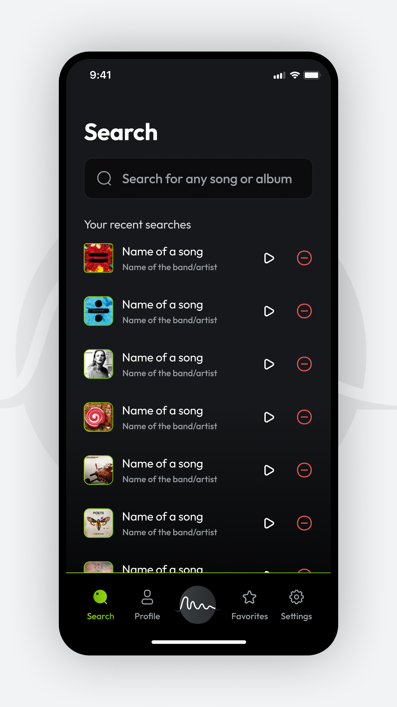
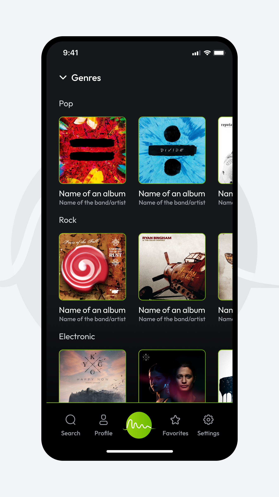
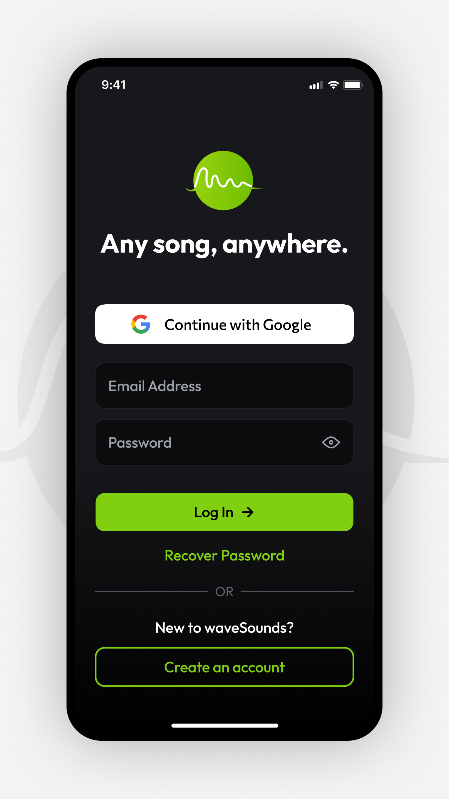
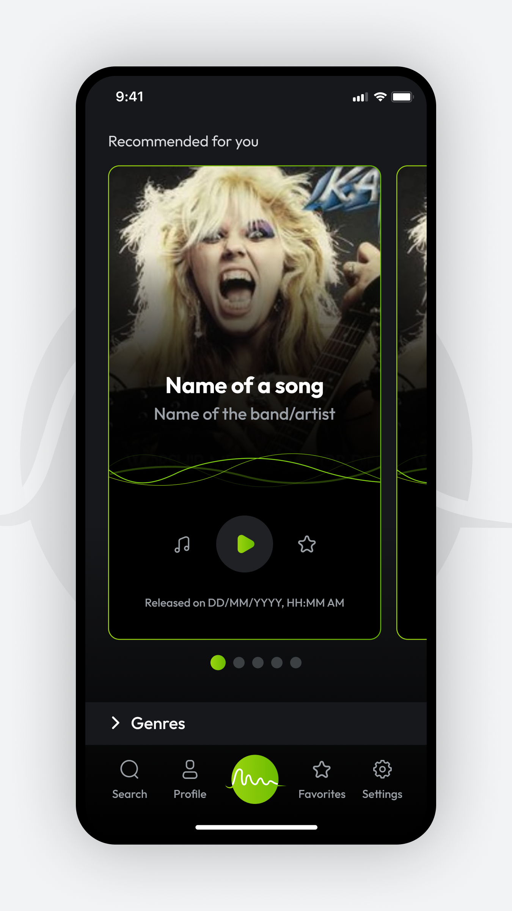
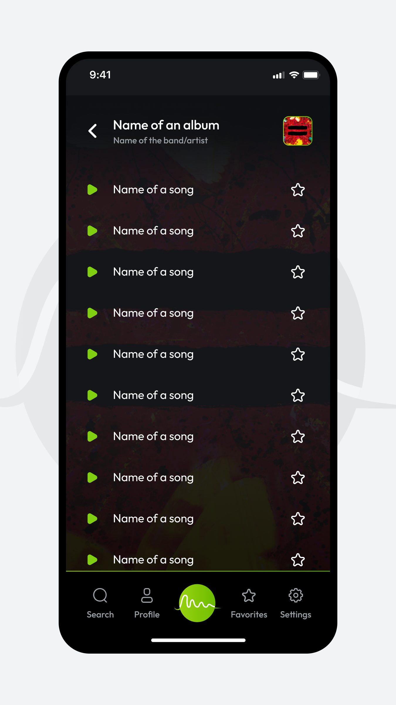

# 🎵 React Native Music Player

A **React Native Music Player** app for **iOS & Android**, built with **TypeScript**, featuring a **complex UI**, smooth animations, full navigation, and advanced functionality including **Gmail Authentication** and **Voice2Speak**.

> ⚠️ **Note:** This is a **demo project** showcasing a fully-featured music player built with modern React Native practices.

---

## 🧩 Overview

This app is designed to provide an immersive music experience on mobile devices:

- Play and manage music tracks
- Smooth and responsive **animated UI** with **Reanimated**
- Full **gesture support** with **React Native Gesture Handler**
- Secure login via **Gmail authentication**
- Voice control with **Voice2Speak** for playback commands

---

## ✨ Key Features

- 🎵 **Play Music Tracks** – Play local or streamed audio files
- 📱 **Complex UI** – Modern design with multiple screens and tabs
- 🔄 **Smooth Navigation** – Built with **React Navigation**
- 🎨 **Animations & Gestures** – Fully animated interface using **Reanimated** and **Gesture Handler**
- 🔑 **Gmail Authentication** – Sign in securely with Google
- 🗣️ **Voice2Speak Commands** – Control playback using voice commands
- 🌐 **Cross-platform** – Works on both iOS and Android

---

  
  &nbsp;&nbsp;&nbsp;
  
  &nbsp;&nbsp;&nbsp;
  
    &nbsp;&nbsp;&nbsp;
  
    &nbsp;&nbsp;&nbsp;
  

